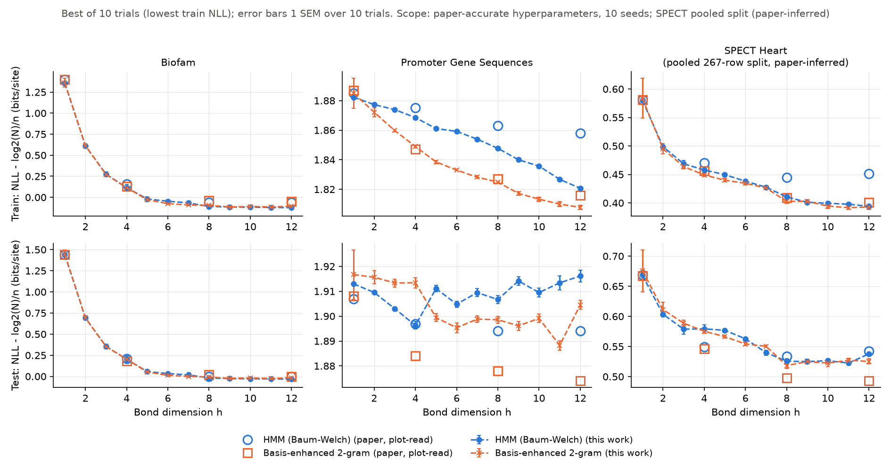
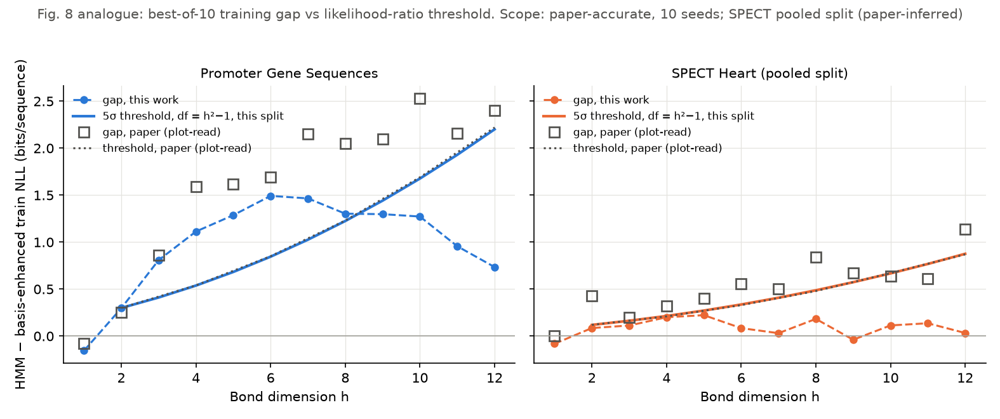
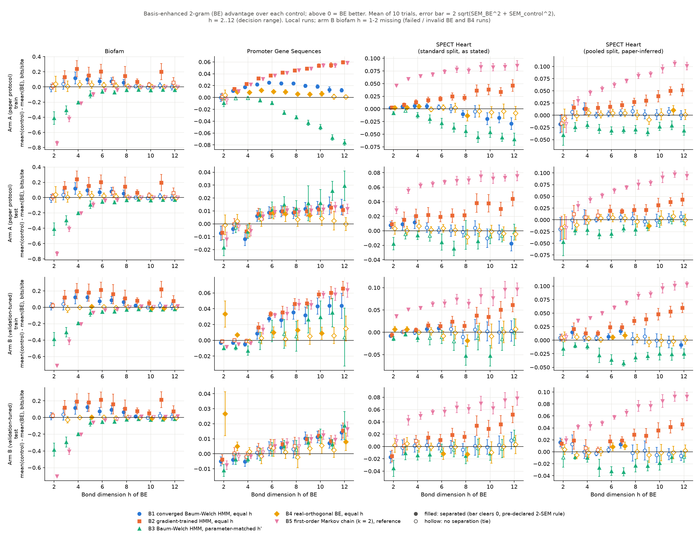
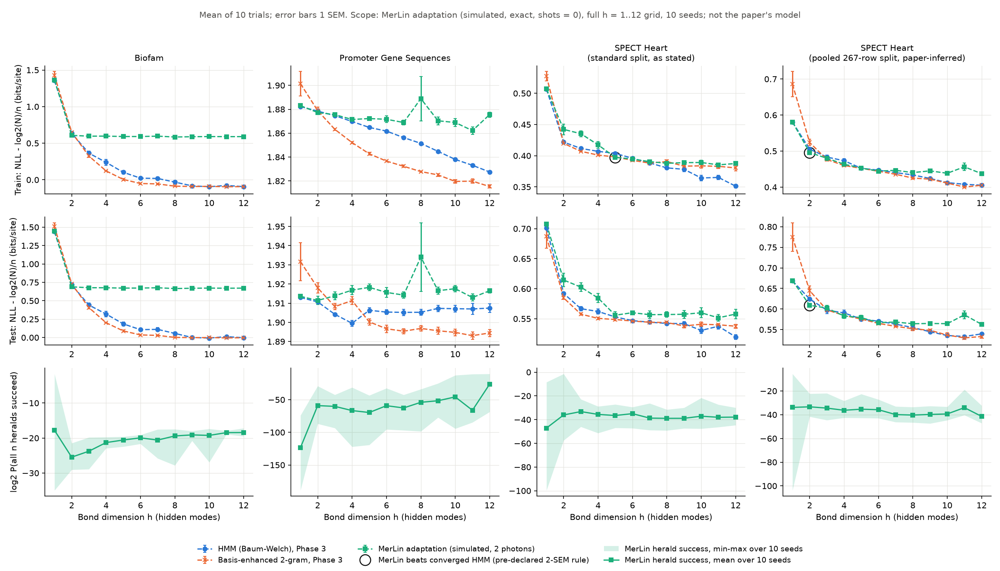

# Enhancing Generative Models via Quantum Correlations - Reproduction

Status: reproduction, photonic adaptation, fair comparison and notebook
complete (phases 1-7). **Start with [`notebook.ipynb`](notebook.ipynb)**: it
walks through the claim, live checks, a live 3-seed run and the stored full
results, about 2-3 min on a laptop CPU. Working record: `LOG.md`; durable
lessons: `INSIGHTS.md`. A pre-handoff check found an error in the
basis-enhanced model's last-site readout; it was fixed and every affected
sweep was rerun. All numbers below come from the rerun (`LOG.md`,
Pre-handoff verification).

**Bottom line.** The paper's basis-enhanced model is reproduced
quantitatively on training data (RMS difference 0.005 bits/site on
Promoters and 0.007 on SPECT at h = 4, 8, 12). Its advantage over an HMM of
the same bond dimension is reproduced on Promoters but not on SPECT, and
the paper's own HMM looks under-trained. Against fair classical baselines
the training advantage is explained by the model's larger parameter count,
and the real-amplitude ablation does not single out complex amplitudes. On
Promoters a small held-out advantage (0.004-0.019 bits/site at h = 7 and
9-12) beats every HMM control on the paper-style test quarter; on five
other random quarters (h = 8 and 12) it holds in 8 of 10 cases, exactly
the pre-declared split-robust threshold. A photonic (MerLin) adaptation shows no advantage.

## Reference and Attribution

- Paper: "Enhancing Generative Models via Quantum Correlations", Physical
  Review X 12, 021037 (2022), published 13 May 2022.
- Authors: Xun Gao, Eric R. Anschuetz, Sheng-Tao Wang, J. Ignacio Cirac,
  Mikhail D. Lukin.
- DOI: [10.1103/PhysRevX.12.021037](https://doi.org/10.1103/PhysRevX.12.021037)
- arXiv: [2101.08354](https://arxiv.org/abs/2101.08354)
- Original repository: none. The paper has no code or data availability
  statement, and GitHub and web searches found no release (`LOG.md`,
  Available Resources). Everything here is reimplemented from the paper.
- License and attribution: the article is open access under CC BY 4.0. This
  reproduction is independent work and cites the article above. Data
  licences are listed under Data.

## Original Paper

**Question.** Do quantum correlations make generative models more
expressive, and where would such an advantage come from?

**Models.** Bayesian networks, a standard class of classical generative
models, can be written as "Bayesian quantum circuits" whose qubits are only
measured in the computational basis. The paper's minimal quantum extension,
the *basis-enhanced* Bayesian quantum circuit, lets each visible qubit be
measured in any local basis. For sequences this is a matrix product state.
Its sequential version, the *basis-enhanced 2-gram model* (Fig. 6a), carries
a quantum memory of dimension h (the bond dimension) from site to site and
emits one symbol per site. The classical counterpart with h hidden states is
a hidden Markov model (HMM).

**Claims.**

- Theorem 1 (Fig. 2): a basis-enhanced 2-gram model built from a cluster
  state cannot be approximated by any classical k-gram model with
  k < floor((n - 1)/2), because of GHZ-type nonlocality.
- Theorem 2: some basis-enhanced 2-gram models need super-polynomially many
  hidden states in a classical HMM, because of contextuality (the
  Mermin-Peres square).
- Numerics (Fig. 7, 8, 13): on two real data sets (Promoter Gene Sequences,
  SPECT Heart), the basis-enhanced model "learns better and generalizes
  better" than an HMM of the same bond dimension h = 1..12. On a control
  data set with mostly local correlations (biofam) the two are comparable.
  The training gap is significant at more than 5 sigma by a
  likelihood-ratio test.
- Sec. VI attributes the gap to complex amplitudes, i.e. quantum
  interference.

**Metric.** The paper plots a per-site "KL divergence" in bits. Its
offset is not stated; it is calibrated here as NLL - log2(N)/n (see
Deviations).

## Reproduction Scope, Claims, and Deviations

Every equation and figure, appendices included, was read from rendered page
images of the PDF (150 and 300 dpi), never from extracted text.

**Reproduced:**

- **Theorem 1 toy model (Fig. 2, Eqs. 4-6, App. F):** exact simulation of
  the cluster-state basis-enhanced 2-gram model for n = 5, 7, 9; the k-gram
  support failure; the 6-state HMM of App. F (E1, E3).
- **App. E robust bound:** maximum-likelihood k-gram l1 distances and the
  Lemma 4/6 random walk (E2).
- **Theorem 2 ingredients:** the Mermin-Peres square (Table I,
  Eqs. 11-14) and the stabilizer counts of Lemma 1 for 1-3 qubits (E4).
  The asymptotic bound itself cannot be tested numerically.
- **Real-data comparison (Fig. 7, Fig. 8, Fig. 13):**
  - Models: the translation-invariant basis-enhanced 2-gram model (BE,
    Fig. 6a), trained by Riemannian momentum descent (Eqs. 22-26), against
    a translation-invariant HMM trained by Baum-Welch.
  - Grid: h = 1..12, 10 seeds each, on biofam, Promoter Gene Sequences and
    SPECT Heart (E5-E7).
  - Paper hyperparameters: beta = 0.5; alpha = 1e-3 (biofam) or 1e-2
    (others); 75 or 150 epochs; minibatch 8.
- **Implementation identities:** Eq. 20 gradient (E8), App. A k-gram -> HMM
  (E9), Fig. 10b collective gate (E10).
- **Photonic adaptation (`PARTIAL_MERLIN_TRANSLATION`):** a heralded
  two-photon photonic quantum HMM simulated with MerLin. Same four data
  arms, h = 1..12, 10 seeds. It is an adaptation, not the paper's model.
- **Fair comparison (independent controls, not in the paper):**
  - Controls: converged HMM (B1), gradient-trained HMM (B2),
    parameter-matched HMM (B3), real-orthogonal BE (B4) and order-k counting
    models (B5).
  - Protocols: the paper's protocol, and a validation-tuned protocol with
    early stopping.
  - Runs: 588 tuning runs and 3444 final runs.

Not reproduced: Theorem 3 (App. B3; complexity-theoretic, proof only) and
the Sec. II/VI interpretation about barren plateaus (not tested in the
paper).

**Claim verdicts.** The detailed evidence is in the sections below.

| ID | Claim | Verdict |
|---|---|---|
| C1 | Theorem 1: k-gram models with k < floor((n-1)/2) fail on the cluster-state model | **Supported** (exact, n = 5, 7, 9) |
| C1b | App. E: l1 distance >= 1/288 | **Supported** numerically (l1 = 0.336 at n = 7, 0.333 at n = 11) |
| C2 | Theorem 2: D^Omega(log D) hidden states needed | Ingredients verified; the asymptotic bound is not testable |
| C3 | Learns and generalizes better than an HMM at equal h (Promoters, SPECT); comparable on biofam | **Partially supported**, details below |
| C4 | Training gap > 5 sigma (Fig. 8) | **Partially supported** as stated: 5 sigma on Promoters at h = 3-8 against a converged HMM, never on SPECT. Explained by parameter count at every h (survives parameter matching nowhere) |
| C5 | Separation persists in the mean over 10 trials (Fig. 13) | **Partially supported**: Promoters test at h = 5-12 against every HMM control; not on train once parameter count is matched; not on SPECT |
| Sec. VI | The gap comes from complex amplitudes | **Not supported**: the real-amplitude version (B4) is beaten on both train and test at no more than one h (Promoters h = 3); B4 also has only 53-67% of BE's parameters |
| C6 | Theorem 3 (complexity separation) | Out of scope (proof only) |
| C7-C10 | Tensor-network form, Eq. 20 gradient, App. F 6-state HMM, App. A, Fig. 10b | **Supported** (exact checks; Fig. 10b up to an Rz convention) |

C3 per data set:

- **Promoters:** better than the equal-h HMMs on train at h >= 3, but a
  parameter-matched HMM fits better at h = 2 and 5-12. Better on held-out
  data than every HMM control at h = 7, 9, 10, 11 and 12, by 0.004-0.019
  bits/site, on the one test quarter used by the comparison (see the
  split-seed check under Fair Baselines).
- **SPECT:** not supported on either split, against any control.
- **biofam:** "comparable" holds by eye at best-of-10. Under the mean-based
  rule the differences exceed 0.05 bits/site in both directions.

**Updates and deviations:**

- **Plotted metric (not stated with the figures):** the "KL divergence" of
  Figs. 7, 8 and 13 is calibrated as NLL - log2(N)/n bits per site (KL from
  the uniform distribution over the N evaluated rows). It is implied by the
  text under Eq. B7 (p19), matches the paper's h = 1 points and explains
  the negative biofam training values.
- **Last-site readout:** at the last site the top wire is traced after U_o
  (Figs. 6a, 6b, 12a), so p(m) is the sum of all entries of rho G_m. An
  earlier version took the trace; it was found before handoff, fixed and
  tested against the explicit amplitude formula, and every BE and B4 sweep
  was rerun. The fix also changes the free-parameter count to
  (M + 1) h^2 - 2 and the matched HMM sizes of B3.
- **Fig. 8 test (not stated):** a one-sided 5-sigma Wilks test with
  df = h^2 - 1 reproduces both threshold curves within 0.02 bits.
- **SPECT split:** the text names the standard SPECT test set, but the
  paper's own numbers match a pooled 267-row split with a random quarter
  held out. Both splits are run; the standard split is the as-stated arm.
- **HMM baseline:** Baum-Welch runs to convergence (cap 2000 iterations,
  relative tolerance 1e-8). The paper does not state its stopping rule.
- **Random test quarter** for biofam and Promoters: split seed 0 (not
  stated).
- **Fig. 8 gap** uses the best-on-train trial (pre-declared). The per-panel
  minimum over trials is reported separately and labelled as selection on
  test.
- **Optimiser sign:** the descent direction of Abrudan et al.; Eqs. 25-26
  as printed would ascend (Eq. 25 also carries a double overline).
- **Partial minibatches:** the last minibatch of an epoch is smaller
  (biofam 4 sequences, pooled SPECT 1); the paper does not say how it
  handles them.
- **Precision and hardware:** double precision on CPU.
- **Phase 5 controls** are additions, not part of the paper; see Fair
  Baselines.

## Project Layout

```text
papers/quantum_correlations_generative_models/
|-- README.md, LOG.md, INSIGHTS.md, FEEDBACK.md, CONFLUENCE.md, VISITED_URLS.md
|-- requirements.txt, cli.json, notebook.ipynb
|-- configs/            defaults, smoke, E1/E2/E4, e5_fig7_<arm>_<variant>.json, sweeps/*.json
|-- lib/
|   |-- runner.py              train_and_evaluate(cfg, run_dir)
|   |-- basis_enhanced.py      BE model (Fig. 6a), Riemannian optimiser, parameter counts
|   |-- hmm.py                 translation-invariant HMM, Baum-Welch
|   |-- hmm_gradient.py        B2: HMM trained by minibatch gradients
|   |-- kgram.py               B5: order-k counting model
|   |-- photonic_hmm_merlin.py MerLin adaptation (M3)
|   |-- cluster_bbqc.py, stabilizer.py   Theorem 1 / 2 constructions
|   |-- data.py, metrics.py, training.py, experiment_logging.py
|-- tests/              140 tests (models, calibration, controls, MerLin, runner, CLI)
|-- utils/              sweep coordinator, summaries, comparisons, plots, selection
|-- results/            curated figures, comparison tables, sweep summaries
|-- models/             (empty; no trained model is kept)
`-- outdir/             raw runs and sweeps (disposable, not committed)
```

## Install and How to Run

```bash
python -m venv .venv
source .venv/bin/activate
pip install -r papers/quantum_correlations_generative_models/requirements.txt
```

```bash
# From the repository root
python implementation.py --paper quantum_correlations_generative_models --help
python implementation.py --paper quantum_correlations_generative_models --config configs/smoke.json

# From inside papers/quantum_correlations_generative_models
python ../../implementation.py --config configs/smoke.json
```

Quick smoke runs (seconds):

```bash
python implementation.py --paper quantum_correlations_generative_models --config configs/smoke.json
python implementation.py --paper quantum_correlations_generative_models --config configs/smoke_classical.json
python implementation.py --paper quantum_correlations_generative_models --config configs/smoke_merlin.json
```

Exact experiments (seconds each):

```bash
python implementation.py --paper quantum_correlations_generative_models --config configs/e1_theorem1_toy.json
python implementation.py --paper quantum_correlations_generative_models --config configs/e2_robust_l1.json
python implementation.py --paper quantum_correlations_generative_models --config configs/e4_mermin_peres.json
```

One Fig. 7 cell (one model, one h, one seed):

```bash
python implementation.py --paper quantum_correlations_generative_models --config configs/e5_fig7_promoters_original.json --bond-dim 8 --seed 0
python implementation.py --paper quantum_correlations_generative_models --config configs/e5_fig7_promoters_classical.json --bond-dim 8 --seed 0
```

Full Fig. 7 / 8 / 13 reproduction and its analysis. The main sweep is 720
runs (about 1.5 h on 6 CPU workers); the SPECT pooled-split arm adds 240
runs (about 1 h).

```bash
python papers/quantum_correlations_generative_models/utils/run_sweep.py --sweep-name e5_fig7 --workers 6
python papers/quantum_correlations_generative_models/utils/run_sweep.py --sweep-name e5_fig7_spect_pooled --datasets spect_heart --config-variant _pooled --workers 6

cd papers/quantum_correlations_generative_models
E5=outdir/sweeps/<e5_fig7 sweep id>; PO=outdir/sweeps/<pooled sweep id>; PV=results/paper_values_fig7_fig8.json
python utils/summarize_fig7.py $E5; python utils/summarize_fig7.py $PO
python utils/compare_with_paper.py $E5 $PO --paper-values $PV --out results/fig7_comparison
python utils/build_results_table.py --phase3 $E5 $PO --out results/paper_item_table
python utils/diagnose_hmm_iterations.py $E5 $PO --paper-values $PV --out results/hmm_iteration_caps.json
python utils/plot_fig7.py $E5 $PO --statistic best --paper-values $PV --out-dir results --name fig7_reproduction_pooled_spect --scope "paper-accurate hyperparameters, 10 seeds; SPECT pooled split (paper-inferred)"
python utils/plot_fig7.py $E5 --statistic best --paper-values $PV --out-dir results --name fig7_reproduction_stated_split --scope "paper-accurate, 10 seeds, SPECT standard split as stated"
python utils/plot_fig7.py $E5 $PO --statistic mean --paper-values $PV --out-dir results --name fig13_reproduction_pooled_spect --scope "paper-accurate hyperparameters, 10 seeds; SPECT pooled split (paper-inferred)"
python utils/plot_fig8.py $E5 $PO --paper-values $PV --out-dir results --name fig8_reproduction_pooled_spect --scope "paper-accurate, 10 seeds; SPECT pooled split (paper-inferred)"
python utils/plot_hmm_caps.py $E5 $PO --caps-json results/hmm_iteration_caps.json --paper-values $PV --out-dir results --name hmm_convergence_diagnostic
```

MerLin adaptation and its comparison with the Phase 3 sweeps. The main
sweep is 360 runs (about 3.3 h on 6 CPU workers); the pooled-SPECT arm adds
120 runs (about 30 min).

```bash
python papers/quantum_correlations_generative_models/utils/run_sweep.py --sweep-name e5_merlin --datasets biofam promoter_gene_sequences spect_heart --model-kinds photonic_merlin --workers 6
python papers/quantum_correlations_generative_models/utils/run_sweep.py --sweep-name e5_merlin_spect_pooled --datasets spect_heart --model-kinds photonic_merlin --config-variant _pooled --workers 6

cd papers/quantum_correlations_generative_models
ME=outdir/sweeps/<e5_merlin sweep id>; MP=outdir/sweeps/<e5_merlin_spect_pooled sweep id>
python utils/compare_photonic.py --merlin $ME $MP --phase3 $E5 $PO --out results/photonic_comparison
python utils/plot_photonic_comparison.py results/photonic_comparison.json --sweep-dirs $ME $MP --out-dir results --name photonic_merlin_comparison
```

Fair comparison. The steps are tuning (588 runs, about 1 h on 6 CPU workers),
hyperparameter selection, finals (3444 runs, about 5.3 h), then the
comparison and figures. The selection script writes the finals spec.

```bash
python papers/quantum_correlations_generative_models/utils/run_sweep.py --sweep-name smoke_phase5 --spec papers/quantum_correlations_generative_models/configs/sweeps/smoke_phase5.json --workers 6
python papers/quantum_correlations_generative_models/utils/run_sweep.py --sweep-name phase5_tuning --spec papers/quantum_correlations_generative_models/configs/sweeps/phase5_tuning.json --workers 6

cd papers/quantum_correlations_generative_models
TU=outdir/sweeps/<phase5_tuning sweep id>
python utils/summarize_fig7.py $TU
python utils/select_hyperparameters.py $TU --out results/phase5_tuning_selection --finals-spec configs/sweeps/phase5_finals.json
cd ../..
python papers/quantum_correlations_generative_models/utils/run_sweep.py --sweep-name phase5_finals --spec papers/quantum_correlations_generative_models/configs/sweeps/phase5_finals.json --workers 6

cd papers/quantum_correlations_generative_models
FI=outdir/sweeps/<phase5_finals sweep id>
python utils/summarize_fig7.py $FI
python utils/compare_phase5.py --phase3 $E5 $PO --merlin $ME $MP --finals $FI --out results/phase5_comparison
python utils/plot_phase5_comparison.py results/phase5_comparison.json --sweep-dirs $FI --out-dir results --name phase5_comparison
```

One fair-comparison cell, e.g. the gradient-trained HMM with validation
tuning:

```bash
python implementation.py --paper quantum_correlations_generative_models --config configs/e5_fig7_promoters_val_gradient.json --bond-dim 8 --lr 0.01 --seed 0
```

Outputs:
- **Each run** writes `outdir/run_YYYYMMDD-HHMMSS/` with
  `config_snapshot.json`, `run.log`, `run_status.json`, `metrics.json`
  (per-epoch history, checkpoint) and, for sequence models,
  `model_state.pt`.
- **Each sweep** writes `outdir/sweeps/<sweep id>/` with `sweep.log`,
  `sweep_status.json`, `summary.json` and `summary.csv`.
- **Curated copies** of the evidence sweeps' `summary.csv` files are in
  `results/sweep_summaries/`.
- **Per-seed metrics** of every planned run of those sweeps (valid, invalid
  or failed) are in `results/per_seed_metrics.csv`, which the notebook
  reads. They are regenerated with
  `python utils/export_per_seed_metrics.py $E5 $PO $ME $MP $TU $FI --out results/per_seed_metrics.csv`.

Notebook (from inside the paper folder; needs `jupyter` and the data under
`data/`):

```bash
jupyter nbconvert --to notebook --execute --inplace notebook.ipynb
```

## Configuration

`cli.json` is the authoritative paper-specific CLI schema:
- **Core flags:** `--epochs`, `--batch-size`, `--lr`, `--bond-dim`,
  `--em-iterations`, `--sweep-id`.
- **Fair-comparison flags:** `--pseudo-count`, `--smoothing`, `--order`,
  `--checkpoint`.
- **Global flags** from the shared runtime: `--config`, `--outdir`,
  `--seed`, `--dtype`, `--device`, `--log-level`.

| Config | Purpose |
|---|---|
| `configs/defaults.json` | Lightweight runnable default (SPECT, BE, h = 2, 2 epochs); `evaluation.checkpoint = "final"` |
| `configs/smoke.json`, `smoke_classical.json`, `smoke_merlin.json` | Seconds-long smoke runs |
| `configs/e1_theorem1_toy.json`, `e2_robust_l1.json`, `e4_mermin_peres.json` | Exact experiments |
| `configs/e5_fig7_<arm>_original.json` | BE with the paper's hyperparameters (`<arm>` in biofam, promoters, spect, spect_pooled) |
| `configs/e5_fig7_<arm>_classical.json` | Baum-Welch HMM on the same split |
| `configs/e5_fig7_spect_pooled_*.json` | SPECT pooled, paper-inferred split (`dataset.test_fraction = 0.25`) |
| `configs/e5_fig7_<arm>_merlin.json` | MerLin adaptation: Adam, lr 0.01, the paper's epochs and minibatch |
| `configs/e5_fig7_<arm>_{real,gradient,kgram}.json` | B4, B2, B5 under the paper protocol |
| `configs/e5_fig7_<arm>_val_{original,real,gradient,classical,kgram}.json` | Validation-tuned arm: `dataset.validation_fraction = 0.2`, `evaluation.checkpoint = "best_validation"` |
| `configs/sweeps/{smoke_phase5,phase5_tuning,phase5_finals}.json` | Fair-comparison sweep specs (the finals spec is generated) |

## Data

Paper sources and datasets live under
`data/quantum_correlations_generative_models/` (not committed). The paper
PDF is cached at
`data/quantum_correlations_generative_models/sources/paper_main.pdf`.

The three data sets of Sec. V C are the originals named by the paper,
complete (no subsampling):

| Data set | Paper size | Source | Local path | License |
|---|---|---|---|---|
| SPECT Heart | n = 23, M = 2; standard 80 train / 187 test split | UCI ML Repository (paper Ref. [47]), DOI 10.24432/C5P304 | `data/quantum_correlations_generative_models/spect_heart/raw/SPECT.{train,test}` | CC BY 4.0 |
| Promoter Gene Sequences | n = 57, M = 4; 106 sequences, class label dropped | UCI ML Repository (paper Ref. [47]), DOI 10.24432/C5S01D | `data/quantum_correlations_generative_models/promoter_gene_sequences/raw/promoters.data` | CC BY 4.0 |
| biofam | n = 16, M = 8; 2000 sequences, ages 15-30 | TraMineR 2.2-14 on CRAN (official distribution by the authors of paper Refs. [45,46]; Swiss Household Panel 2002) | `data/quantum_correlations_generative_models/biofam/biofam.csv` (columns `a15`..`a30`), converted from `raw/TraMineR/data/biofam.RData` | GPL (>= 2) package; SHP data |

Acquisition, from the repository root (checksums and the full command list
are in `LOG.md`, Data Acquisition Log):

```bash
D=data/quantum_correlations_generative_models
curl -sSL -o "$D/spect_heart/spect+heart.zip" "https://archive.ics.uci.edu/static/public/95/spect+heart.zip"
curl -sSL -o "$D/promoter_gene_sequences/molecular+biology+promoter+gene+sequences.zip" "https://archive.ics.uci.edu/static/public/67/molecular+biology+promoter+gene+sequences.zip"
curl -sSL -o $D/biofam/TraMineR_2.2-14.tar.gz "https://cran.r-project.org/src/contrib/TraMineR_2.2-14.tar.gz"
```

Splits:
- **Test split:** biofam and Promoters ship without one. The paper holds
  out "a quarter of the data" without saying which, so this reproduction
  draws that quarter with split seed 0. Promoters: 80 train / 26 test;
  biofam: 1500 / 500.
- **Validation split (fair comparison):** 20% of the training pool, drawn
  from a second permutation, so the test sets are identical under both
  protocols.
- **File versions:** the paper does not name the releases it used; the
  files here are the long-standing versions (SPECT 2001, Promoters 1990,
  biofam 2012).

## Results Obtained and Comparison with the Paper

Scope: **paper-accurate** (full data, paper hyperparameters, 10 seeds per
cell; 960 validated runs in two complete sweeps).
- **Paper values** are read by eye from 300-dpi crops of Fig. 7 and Fig. 8
  (`results/paper_values_fig7_fig8.json`; precision +-0.002-0.02 bits/site).
- **Units:** values are in the paper's metric, NLL - log2(N)/n, in bits
  per site.
- **"Best"** means the trial with the lowest train NLL out of 10 (ties
  within 1e-6 bits go to the lowest seed).

### Exact experiments

| Claim | Result | Paper |
|---|---|---|
| Theorem 1 (Fig. 2) | The smallest ML k-gram order whose support equals the target is k = n (n = 5, 7, 9). Lower orders put 17% of their mass outside the support, so the forward KL is infinite | k-gram fails for k < floor((n-1)/2) |
| App. E | ML k-gram l1 = 0.336 (n = 7), 0.333 (n = 11) | l1 >= 1/288 |
| App. F | A 6-state HMM equals the model to 1e-18 or better (n = 5, 7, 9) | bond dimension 6 suffices |
| Table I, Lemma 1 | Commutation relations exact; stabilizer counts 6, 60, 1080 | same |

### Fig. 7: best of 10 trials, training data

| Data set | h | Basis-enhanced (ours / paper) | HMM, converged (ours / paper) |
|---|---|---|---|
| Promoters | 4 | 1.849 / 1.847 | 1.869 / 1.875 |
| Promoters | 8 | 1.825 / 1.827 | 1.848 / 1.863 |
| Promoters | 12 | 1.808 / 1.816 | 1.821 / 1.858 |
| SPECT, pooled split | 4 | 0.449 / 0.456 | 0.458 / 0.470 |
| SPECT, pooled split | 8 | 0.403 / 0.409 | 0.411 / 0.445 |
| SPECT, pooled split | 12 | 0.393 / 0.401 | 0.394 / 0.451 |
| biofam | 4 | 0.114 / 0.13 | 0.115 / 0.16 |
| biofam | 12 | -0.108 / -0.05 | -0.124 / -0.06 |

- **The basis-enhanced model is quantitatively reproduced** on training
  data: RMS difference 0.005 bits/site on Promoters and 0.007 on the
  pooled SPECT split (h = 4, 8, 12).
- **Our converged HMM is better than the paper's** by 0.007-0.037
  bits/site on Promoters and 0.012-0.057 on pooled SPECT, growing with h.
  - The paper's HMM points match our HMM stopped after about 100
    (Promoters) or 50 (SPECT) Baum-Welch iterations
    (`results/hmm_convergence_diagnostic.png`).
  - The trained HMMs pass a known-answer check: their probabilities sum to
    1 over all 2^23 SPECT sequences.
- **Test data, h = 12, best trial (ours / paper):**

  | Data set | Basis-enhanced | HMM |
  |---|---|---|
  | Promoters | 1.905 / 1.874 | 1.916 / 1.894 |
  | SPECT, pooled split | 0.525 / 0.493 | 0.538 / 0.542 |

  - On pooled SPECT the test differences (up to 0.032) are within 2 SD of
    the split-to-split spread of a random quarter (SD 0.018 at h = 1).
  - On Promoters they are not: the basis-enhanced test values are 0.021-0.031
    above the paper at h = 4, 8, 12, 6-9 times the split SD of 0.0035 (at
    h = 1). The training values match, so the gap is a held-out one that
    the unknown test quarter alone does not explain.
- **biofam:** the training values sit below the paper for both models
  (-0.037 / -0.043 at h = 1, -0.016 to -0.064 at h = 4, 8, 12), while the
  test values agree within 0.03. The offset is a data difference (R12); it
  is not constant in h.
- **Standard SPECT split** (as stated in the text): the converged HMM beats
  the basis-enhanced model at h = 8 and 10-12 on train (h = 12: 0.341 vs
  0.353). The paper's h = 1 point does not match this split (0.507 vs
  0.581).





Also: `results/fig7_reproduction_stated_split.png`,
`results/fig13_reproduction_pooled_spect.png` (mean of 10 trials) and
`results/hmm_convergence_diagnostic.png`.

### Fig. 8: likelihood-ratio test of the training gap (bits per sequence)

| Data set | Gap h = 4 / 8 / 12 (ours) | Gap (paper) | 5σ threshold (ours = paper) | Significant at h (ours / paper) |
|---|---|---|---|---|
| Promoters | 1.11 / 1.30 / 0.74 | 1.59 / 2.05 / 2.40 | 0.54 / 1.23 / 2.20 | 3-8 / 3-12 |
| SPECT, pooled split | 0.20 / 0.18 / 0.03 | 0.32 / 0.84 / 1.14 | 0.21 / 0.49 / 0.88 | none / most h |

### Every plotted paper item

`results/paper_item_table.{md,csv}` (generated by
`utils/build_results_table.py` from the structured artifacts) compares 70
items. Each item is one Fig. 7 point (data set, split, h = 1, 4, 8, 12,
model) or one Fig. 8 gap at h = 4, 8, 12. All 70 use 10 seeds. Agreement
categories, declared with the table (bits/site):
- **match:** |Δ| <= 0.01.
- **within test-split spread:** a test value on a randomly drawn quarter
  with |Δ| <= 2 SD of that data set's split spread (Promoters 0.007,
  SPECT pooled 0.036, biofam 0.042). The standard SPECT split is fixed, so
  it gets no such tolerance.
- **biofam offset:** the documented biofam data offset, Δ in [-0.08,
  -0.02].
- **differs:** anything else.
- **Fig. 8 gaps:** match if |Δ| <= 0.06 bits/sequence.

| Item group | match | within split spread | biofam offset | differs | Reading |
|---|---:|---:|---:|---:|---|
| Fig. 7 Promoters, train | 6 | 0 | 0 | 2 | BE 4/4 match; the 2 differing are the converged HMM at h = 8, 12 |
| Fig. 7 Promoters, test | 3 | 0 | 0 | 5 | BE 0.021-0.031 and HMM 0.013-0.022 above the paper at larger h; more than the split spread explains |
| Fig. 7 SPECT pooled, train | 5 | 0 | 0 | 3 | BE 4/4 match; the converged HMM is better at h = 4, 8, 12 |
| Fig. 7 SPECT pooled, test | 4 | 4 | 0 | 0 | All within 2 SD of the random-quarter spread |
| Fig. 7 SPECT standard, train / test | 3 | 0 | 0 | 13 | The paper's values belong to the pooled split (R6) |
| Fig. 7 biofam, train / test | 3 | 5 | 7 | 1 | Training-data offset (R12); BE h = 4 train is 0.016 below the paper |
| Fig. 8 Promoters, SPECT pooled | 0 | 0 | 0 | 6 | Smaller gaps against a converged HMM. Same 5-sigma decision at Promoters h = 4, 8; different at Promoters h = 12 and on SPECT |

Ranking (trend) agreement, HMM - BE sign per point:
- **Promoters and SPECT pooled training data:** same as the paper at
  h = 4, 8, 12, except SPECT pooled h = 12, where the paper shows BE better
  and ours is a tie.
- **h = 1:** several of the paper's ties appear here as BE slightly worse,
  by up to 0.007 bits/site.
- **biofam and Promoters test at h = 4:** the paper shows BE better; here
  they tie (biofam) or BE is worse (Promoters test).
- **Full table:**
  <details><summary>show</summary>

  See [results/paper_item_table.md](results/paper_item_table.md).

  </details>

### Sweeps

Metric: per-site NLL in bits, lower is better; the paper metric differs
by a constant per split. Aggregation: mean, std and SEM over seeds, plus
best-of-10. No sweep selects a winner, except tuning. Full candidate
tables:
- the `results/sweep_summaries/<sweep id>_summary.csv` files;
- tuning: `results/phase5_tuning_selection.json`.

Run counts: "valid" runs completed and entered aggregates; "invalid" runs
completed but were excluded because a BE or B4 run left the unitary group
(unitarity error > 1e-6 at the checkpoint); "failed" runs did not complete
in either of the two allowed attempts.

| Sweep | Purpose | Split / checkpoint | Valid / invalid / failed of planned | Coverage |
|---|---|---|---|---|
| `e5_fig7_20261113-101421` | BE and HMM, biofam, Promoters, SPECT standard, h = 1..12 | train, test / final epoch | 720 / 0 / 0 of 720 | COMPLETE |
| `e5_fig7_spect_pooled_20261113-114428` | Same, SPECT pooled split | train, test / final epoch | 240 / 0 / 0 of 240 | COMPLETE |
| `e5_merlin_20261112-132728` | MerLin adaptation, three arms | train, test / final epoch | 360 / 0 / 0 of 360 | COMPLETE |
| `e5_merlin_spect_pooled_20261112-164320` | MerLin adaptation, SPECT pooled | train, test / final epoch | 120 / 0 / 0 of 120 | COMPLETE |
| `phase5_tuning_20261113-124847` | Hyperparameter tuning (h = 4, 8, 12, seeds 0-2) | validation / best validation | 584 / 1 / 3 of 588 | PARTIAL: all 4 at biofam, h = 4, lr 0.03 (BE seed 2 and B4 seeds 0, 2 failed twice; B4 seed 1 invalid) |
| `phase5_finals_20261113-134830` | Fair-comparison finals, both protocols | train, validation, test / final or best validation | 3414 / 3 / 27 of 3444 | PARTIAL: all at biofam, validation-tuned (BE h = 1: 10 failed; B4 h = 1: 10 failed; B4 h = 2: 7 failed + 3 invalid) |

The tuning selection comes from a PARTIAL sweep; its selection rules are
under Fair Baselines. The sweeps run before the readout fix are superseded
(listed in `LOG.md`, Rerun ledger); their summaries are kept in
`results/sweep_summaries/superseded/`. The Baum-Welch runs of the rerun
reproduce the superseded ones exactly.

## Fair Baselines

**Why the paper's baseline is not enough.** The paper compares its model
only with a Baum-Welch HMM of the same bond dimension h, and three
differences confound that comparison:
- at equal h, BE has 2-6 times more free parameters (Promoters h = 8: 318
  vs 87);
- the two models are trained by different algorithms;
- neither is tuned or early-stopped.

Baseline state: `MISSING_OR_UNFAIR`. The controls below are independent
additions, decided and frozen in `LOG.md` ("Phase 5 Comparison Plan", plus
two amendments) before any final run.

| Control | What it isolates | Matching |
|---|---|---|
| B1 converged Baum-Welch HMM | the paper's baseline, trained to convergence | equal h |
| B2 HMM trained by minibatch SGD with momentum | training algorithm | equal h, BE's batch and epochs |
| B3 Baum-Welch HMM at h' | parameter count | smallest h' with at least BE's free parameters (e.g. Promoters h = 8 -> h' = 17) |
| B4 BE with real orthogonal matrices | complex amplitudes (Sec. VI) | equal h, same optimiser |
| B5 order-k counting model, k = 1-3 | simple classical reference | none (reference only) |

Protocols and rules:
- **Arm A, paper protocol:** no validation split, final-epoch checkpoint.
  BE and B1 are the reproduction runs; B2 uses the arm-B learning rate, B4
  the paper's alpha.
- **Arm B, validation-tuned:** 20% of the training pool is held out for
  validation. Every model gets the same budget:
  - grid: lr in {1e-3, 3e-3, 1e-2, 3e-2}; Baum-Welch pseudo-count in
    {0, 1e-3, 1e-2}; B5 smoothing in {0.01, 0.1, 0.5, 1};
  - tuning runs at h = 4, 8, 12 and seeds 0-2;
  - checkpoint: the epoch with the lowest validation NLL;
  - the test set is never used for a choice.
- **Selection rule:** lowest mean validation NLL. Values within 1e-3 bits
  tie and go to the paper value; otherwise to the tied value closest to it
  in log scale. A value with a failed run, or with a basis-enhanced run that
  left the unitary group (error > 1e-6), is ineligible.
- **Separation rule:** X beats Y if mean(Y) - mean(X) > 2 sqrt(SEM_X^2 +
  SEM_Y^2) over 10 seeds. A claim is SUPPORTED at >= 9 of h = 2..12,
  PARTIALLY_SUPPORTED at 3-8, UNSUPPORTED at <= 2.

Selected values (`results/phase5_tuning_selection.json` lists every
candidate's score):

| Arm | BE lr | B4 lr | B2 lr | B1/B3 pseudo-count | B5 smoothing k = 1 / 2 / 3 |
|---|---|---|---|---|---|
| biofam | 0.003 (tied with 0.01; 0.03 ineligible) | 0.01 (0.03 ineligible) | 0.03 | 0 (all tied) | 0.5 / 0.1 / 0.1 |
| Promoters | 0.03 | 0.03 | 0.01 (tied with 0.03) | 0 (all tied) | 0.5 / 0.5 / 0.5 (all tied) |
| SPECT standard | 0.03 | 0.03 | 0.03 | 0.01 | 0.5 / 0.5 / 0.5 (all tied) |
| SPECT pooled | 0.03 | 0.03 | 0.03 | 0.01 | 0.5 / 0.5 / 0.5 (all tied) |

**Result scope.** Locally executed, full data, 10 seeds per cell.
- **Lost runs:** arm B lost 10 of 480 BE runs (biofam h = 1, lr 0.003)
  and 20 of 480 B4 runs (biofam h = 1-2, lr 0.01). These runs diverge or
  leave the unitary group, and tuning had only checked h = 4, 8, 12. They
  are reported as failed or invalid, not retried.
- **Full tables:** `results/phase5_comparison.{json,csv}`.



Each point is mean(control) - mean(BE). Above zero, BE is better; a filled
marker means the 2-SEM bar clears zero.

| Claim (rule) | biofam | Promoters | SPECT, standard split | SPECT, pooled split |
|---|---|---|---|---|
| C3 "learns better": BE beats B1, B2 and B3 on train (arm A) | comparable rule fails* | **UNSUPPORTED** (0 h): B3 beats BE at h = 2 and 5-12 | UNSUPPORTED (0 h) | UNSUPPORTED (0 h) |
| C3 "generalizes better": BE beats B1, B2 and B3 on test (arm B) | comparable rule fails* | **PARTIALLY_SUPPORTED** (h = 7, 9, 10, 11, 12) | UNSUPPORTED (0 h) | UNSUPPORTED (0 h) |
| C5 means, paper protocol, test (arm A) | comparable rule fails* | PARTIALLY_SUPPORTED (h = 5-12) | UNSUPPORTED | UNSUPPORTED |
| C4 5σ gap survives parameter matching (BE best-of-10 train below B3's) | 5σ at h = 3, 5, 6, 7; none survives | 5σ at h = 3-8; none survives | no 5σ gap | no 5σ gap |
| Sec. VI complex amplitudes: BE beats B4 on train (A) and test (B) | UNSUPPORTED (0 h; B4 h = 1-2 missing in arm B) | **UNSUPPORTED** (h = 3 only) | UNSUPPORTED (0 h) | UNSUPPORTED (0 h) |

\* biofam "comparable" (no baseline separated from BE by more than 0.05
bits/site at h >= 4) fails in both directions:
- BE is more than 0.05 better than the equal-h converged HMM at h = 4-8;
- BE is more than 0.05 worse than the parameter-matched HMM at h = 4-7.

What the evidence says:

- **Training fit (expressivity) is explained by parameter count.**
  - BE beats the equal-h HMMs (B1, B2) on Promoters train at every h >= 3.
  - But a Baum-Welch HMM with as many parameters (B3) fits the training
    data better at h = 2 and from h = 5 on (h = 12: 1.851 vs 1.926
    bits/site).
  - The 5σ result survives parameter matching at no h.
- **Promoters shows a small held-out advantage at large h only
  (PARTIALLY_SUPPORTED).**
  - With equal tuning and early stopping, BE's test NLL is lower than B1,
    B2 and B3 at h = 7, 9, 10, 11 and 12 (5 of the 11 values of h), by
    0.004-0.019 bits/site (h = 10: BE 1.9778, B1 1.9890, B2 1.9899,
    B3 1.9895).
  - At h = 2-6 and h = 8 there is no such separation.
  - The comparison uses one test quarter of 26 sequences; its separations
    use the SEM over seeds, not over splits. The split-seed check below
    repeats it on five other quarters.
  - The real-amplitude version (B4) is beaten on test only at h = 2, 3 and
    12; at h = 8 its mean test NLL is lower than BE's (1.9831 vs 1.9853).
    So the held-out advantage is not shown to come from complex
    amplitudes.
- **SPECT shows no advantage** on either split, under either protocol.
- **biofam:** a first-order Markov chain (B5, k = 2, 0.560 bits/site
  test, paper protocol) beats BE up to h = 7 and is not separated from it
  at larger h.
- **The gradient-trained HMM (B2) is never better than the converged
  Baum-Welch HMM.** It is separated as worse in 111 of 176 matched cells
  (h = 2..12, both arms and splits) and better in none. Training the HMM
  with the paper's Baum-Welch did not handicap it.

**Split-seed check (extension, declared in `LOG.md` before it ran).** The
fair comparison above uses one random test quarter (split seed 0). The
validation-tuned Promoters comparison was repeated on split seeds 1-5 (new
test quarter and validation carve-out each), at h = 8 and 12, for BE, B1,
B2 and B3, 10 seeds each (400 runs, all valid), with the hyperparameters
selected on split seed 0. Script: `utils/robustness_split_seeds.py`;
results: `results/robustness_split_seeds_{runs.csv,summary.json}`.

| Split seed | h = 8: BE advantage over B1 / B2 / B3 | h = 12: BE advantage over B1 / B2 / B3 |
|---|---|---|
| 1 | 0.011 / 0.012 / 0.009 (beats all) | 0.010 / 0.010 / 0.010 (beats all) |
| 2 | 0.009 / 0.009 / 0.008 (beats all) | 0.008 / 0.011 / 0.009 (beats all) |
| 3 | 0.008 / 0.010 / 0.023 (beats all) | 0.020 / 0.016 / 0.051 (beats all) |
| 4 | 0.002 / 0.004 / 0.004 (none separated) | -0.000 / 0.002 / 0.001 (none separated) |
| 5 | 0.006 / 0.007 / 0.009 (beats all) | 0.013 / 0.011 / 0.010 (beats all) |

- BE beats all three HMM controls in 8 of 10 cells: **split-robust** under
  the pre-declared label (>= 8), exactly at the threshold.
- Split seed 4 shows no advantage at either h, so the effect is not
  universal across quarters.
- h = 8, not separated on split seed 0, holds on 4 of the 5 new splits.
- Limits: two values of h, no retuning per split, 26-sequence quarters.

Commensurability (full list in the JSON):
- **`COMMENSURABLE`:** arm A BE vs B1, B3 and B4, and every arm B pair.
- **`PARTIALLY_COMMENSURABLE`:**
  - arm A BE vs B2: B2's lr is tuned, while BE keeps the paper's alpha;
  - BE vs B5: no capacity match;
  - MerLin vs any HMM: simulated, untuned;
  - arm B biofam pairs involving BE (h = 1 missing) or B4 (h = 1-2
    missing).

Wall clock (same machine, 6 single-threaded workers), per run:

| Model | Seconds per run, median (range over data sets and h) |
|---|---|
| BE | 40 (8-192) |
| B4 | 29 (6-153) |
| B3 at h' > 12 | 14 (2-141) |
| B2 | 6 (2-26) |
| B1 | 5 (under 1-29) |
| B5 | under 0.01 |
| MerLin | 63 (13-868) |

These are timings of these implementations, not an algorithmic
comparison.

## Photonic Assessment and MerLin Extension

Status: **`PARTIAL_MERLIN_TRANSLATION`**, with medium-high confidence that
the chosen mapping is the minimal faithful photonic counterpart. Label on
every result: *MerLin adaptation (simulated, exact, shots = 0), not the
paper's model.*

- **Role to preserve:** the basis-enhanced model's coherent memory of
  dimension h. Its hidden paths interfere with complex amplitudes, and it
  emits one symbol per site by measuring an ancilla.
- **Mapping (M3):**
  - One photon spread over h hidden modes is the memory.
  - At every site, a probe photon enters mode h, and one trainable
    universal MZI mesh, shared by all sites, acts on all h + M modes.
  - Photon-number-resolving detectors on the M data modes herald the
    symbol when they count exactly one photon.
  - The heralded maps are two-photon permanents
    K_m = U[h+m, h] W + U[:h, h] U[h+m, :h], with W = U[:h, :h].
  - The model distribution is post-selected on all n heralds. Its
    normalisation, the herald success probability, is computed exactly and
    reported.
  - `ComputationSpace.FOCK` is required, because `UNBUNCHED` renormalises
    rows and would distort K_m.
- **Rejected mappings** (`LOG.md`, Photonic Translation Assessment):
  - gate-level two-photon qudits (KLM-style gates);
  - a one-photon reparameterisation;
  - more photons per step;
  - one big interferometer for the whole sequence.
- **Excluded:** the theorem experiments E1-E4, and the Fig. 8
  likelihood-ratio test (its null model, the HMM, is not contained in M3).
- **Changed:**
  - K_m is restricted to the two-photon form above;
  - the memory is pure, instead of the traced wire of Fig. 6a;
  - post-selection is global;
  - training uses Adam on mesh phases instead of Riemannian descent.

Comparison with the reproduced models (mean of 10 trials, paper metric;
rules declared in `LOG.md` before the runs). Full table:
`results/photonic_comparison.csv`.



| Arm | Matches basis-enhanced (best-of-10 train within 0.005) | Beats converged HMM (2 SEM), train / test | MerLin vs HMM, train, h >= 3 | log2 herald success per sequence (mean over seeds) |
|---|---|---|---|---|
| biofam (n = 16, M = 8) | h = 1 | none / none | +0.23 to +0.69 bits/site worse (plateau at 0.59 for every h >= 3) | -26 to -18 |
| Promoters (n = 57, M = 4) | h = 1, 2 | none / none | +0.001 to +0.048 worse | -124 to -26 |
| SPECT standard split (n = 23) | h = 1, 2, 5, 6, 8 | h = 5 / none | -0.006 to +0.036 | -47 to -33 |
| SPECT pooled split | h = 1, 4, 5, 6 | h = 2 / h = 2 | -0.010 to +0.048 | -41 to -33 |

- **Where it keeps up:** with the paper's model only at small h, and on
  SPECT up to h = 7-8. On biofam and Promoters it stops improving after
  h = 2-3.
- **"Beats the HMM" flags:** the three flags are isolated in h. About 2 are
  expected by chance among the 96 uncorrected comparisons, so they are not
  read as an advantage.
- **Why it stops improving:**
  - Training curves are flat from epoch 5 on, so more epochs would not
    help.
  - Structurally, every symbol shares W and c, so the memories reachable
    after one emission span at most two dimensions, whatever h is (tested
    in `tests/test_photonic_merlin.py`). A bigger h therefore cannot store
    more about the past.
- **Against fair baselines** (arm A only; arm B is `N/A` because the
  adaptation was not tuned):
  - it beats neither the equal-h HMM nor the HMM matched to its own
    parameter count, except at isolated points (SPECT h = 5 train, pooled
    SPECT h = 2);
  - the parameter-matched HMM beats it on train at every h on every data
    set, and on test at most h
    (`results/phase5_comparison_merlin.png`).

## Hardware-Aware Settings

| Field | Value |
|---|---|
| Computation space | `ComputationSpace.FOCK` |
| Detector model | Ideal photon-number-resolving detectors on the M data modes; hidden modes not measured, stored coherently between sites |
| Photon number | 2 (memory + probe) |
| Modes | h + M: 9-20 (biofam), 5-16 (Promoters), 3-14 (SPECT) |
| Input state | Memory photon in modes 0..h-1 with trained amplitudes; probe photon in mode h at every site |
| Encoding | Symbol = data mode of the heralded photon |
| Measurement | `MeasurementStrategy.amplitudes(FOCK)`, heralded outcomes |
| Post-selection | Exactly one photon in the data modes at every site |
| Simulator | MerLin 0.4.1, exact CPU simulation, float64; exact autograd gradients; no loss or distinguishability modelled |
| Shots | 0 (exact probabilities) |
| Trainable parameters | (h + M)(h + M - 1) mesh phases + 2h memory amplitudes: 74-404 (biofam), 22-264 (Promoters), 8-206 (SPECT) |
| Wall clock | 21.6 h CPU in total (biofam 15.75 h, Promoters 2.11 h, SPECT 1.05 h, SPECT pooled 2.72 h); longest run 868 s |
| Seeds | 0..9 per (arm, h) |
| Sweeps | `e5_merlin_20261112-132728`, `e5_merlin_spect_pooled_20261112-164320` |

Hardware view:
- Herald success falls exponentially with sequence length.
- One heralded 57-symbol Promoters sample needs about 10^8 to 10^37
  attempts.
- So the scheme is impractical beyond short sequences, even with ideal
  components.
- All results are simulations, not hardware runs.

## Limitations

- **Paper values** are plot readings, not published numbers.
- **Unstated details:** the SPECT split, the test quarters, the biofam data
  version and the paper's HMM stopping rule are not stated. The inferences
  above rest on the paper's own h = 1 points and Fig. 8 thresholds.
- **Untested alternatives:** an HMM trained with BE's minibatch optimiser
  (B2) and validation tuning for every model were tested, and neither
  changes the SPECT verdict. Longer basis-enhanced training and a warm
  start from the HMM were not tested.
- **Tuning grid edge:** several selected learning rates sit at the top of
  the pre-declared grid (0.03), for BE as for B2, so the optimum may lie
  above it.
- **biofam gap in the validation-tuned arm:** the selected learning rates
  on biofam diverge at small h (BE at h = 1 with lr 0.003, B4 at h = 1-2
  with lr 0.01), which tuning at h = 4, 8, 12 could not see. That arm has
  no BE evidence at h = 1 and no B4 evidence at h = 1-2 on biofam.
- **One split per data set:** the fair comparison uses one validation split
  and one test split per data set (split seed 0), so split-to-split
  variation is not in its SEMs. The split-seed check covers Promoters at
  h = 8 and 12 only.
- **Small Promoters effect:** the held-out advantage (0.004-0.019
  bits/site) is small in absolute terms and rests on test quarters of 26
  sequences (the validation-tuned arm trains on 64 and validates on 16).
- **B4 is not parameter-matched:** the real-amplitude ablation has 53-67%
  of BE's free parameters, so a train gap between them mixes the
  amplitude field with parameter count.
- **No hardware:** no QPU or photonic hardware; double-precision CPU
  simulation. The MerLin results are simulations with ideal, lossless
  components.
- **MerLin adaptation:**
  - the learning rate (0.01) was fixed in advance and not tuned;
  - the richer mappings that could lift the two-dimensional memory limit
    (more probe photons per step, or a symbol-dependent mesh) were rejected
    for herald cost and not run;
  - its parameter-matched comparison uses the paper protocol only.
- **Notebook:** the full sweeps are loaded from `results/`, not rerun; only
  the exact checks, one 3-seed Fig. 7 cell and a small MerLin model run
  live.

## Tests

```bash
cd papers/quantum_correlations_generative_models
pytest -q
```

140 tests cover:
- the exact constructions and calibrations: Theorem 1 model, App. F HMM,
  Mermin-Peres relations, stabilizer counts, Eq. 20 gradient, the
  calibrated metric and the Fig. 8 thresholds;
- the models: BE likelihood against the explicit amplitude formula
  (complex and real), free-parameter counts, HMM normalisation and the
  BE-contains-HMM identity, MerLin heralding and the two-dimensional memory
  limit;
- the fair-comparison controls and decision rules;
- the runner, CLI and data loaders.

## Citation and License

```bibtex
@article{gao2022enhancing,
  title   = {Enhancing Generative Models via Quantum Correlations},
  author  = {Gao, Xun and Anschuetz, Eric R. and Wang, Sheng-Tao and Cirac, J. Ignacio and Lukin, Mikhail D.},
  journal = {Physical Review X},
  volume  = {12},
  pages   = {021037},
  year    = {2022},
  doi     = {10.1103/PhysRevX.12.021037}
}
```

The article is CC BY 4.0. The data sets keep their own licences (Data
section). Reproduction code: MIT License (repository `LICENSE`).
